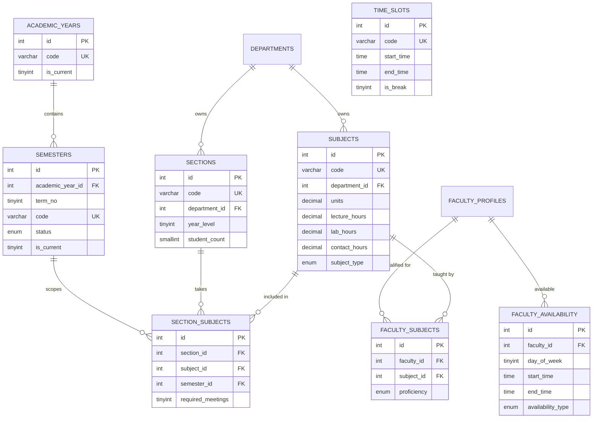
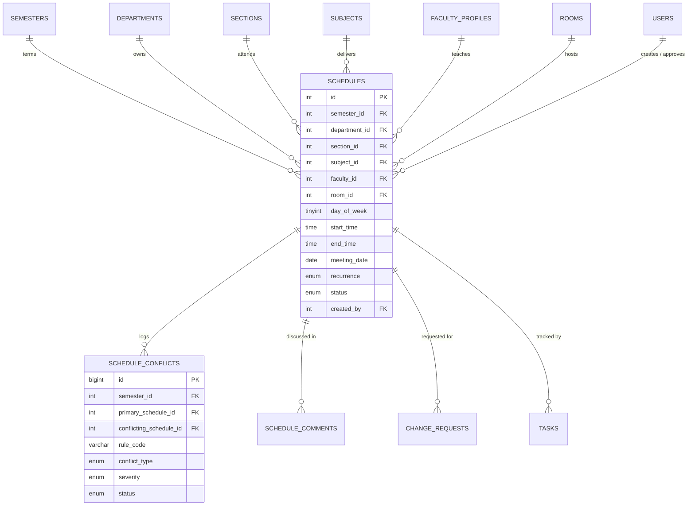
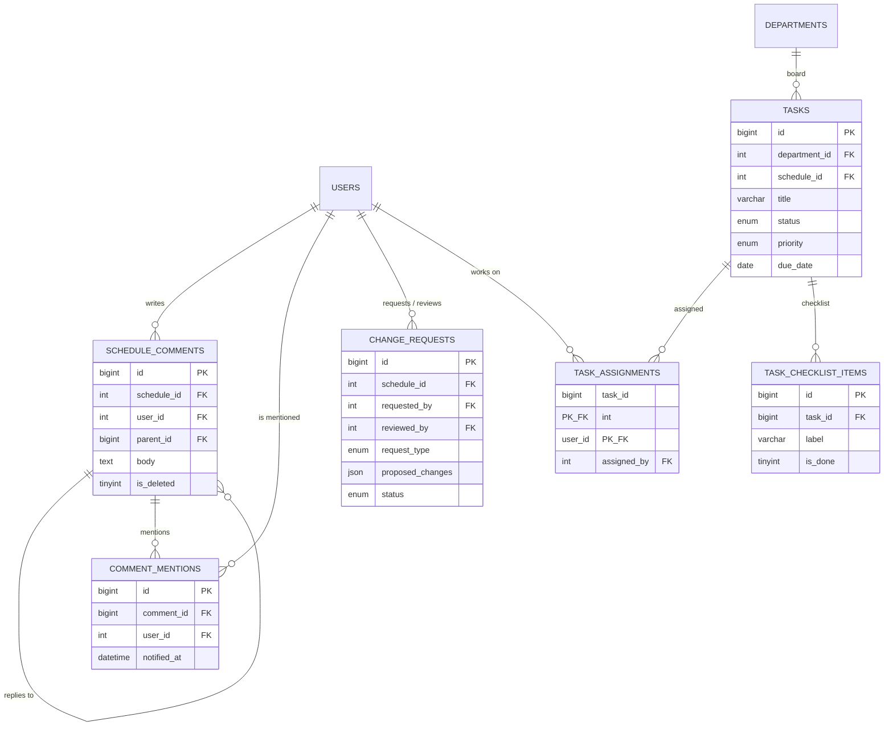
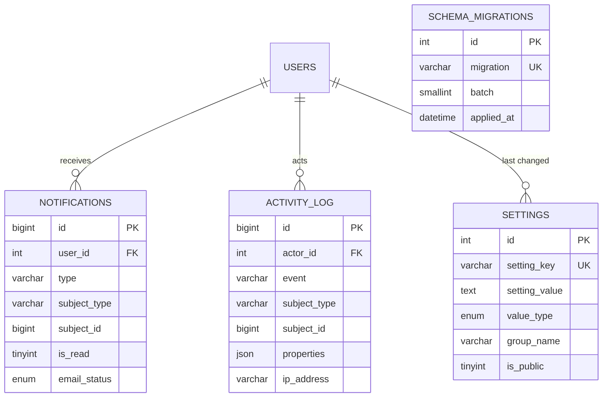

# SyncClass — Entity-Relationship Diagram

**Document:** `database/schema/ERD.md`
**Phase:** 3 of 20 — Database Design
**Companion:** full data dictionary in [`docs/DATABASE.md`](../../docs/DATABASE.md)
**Source of truth:** `database/migrations/*.up.sql`

The diagrams below are generated from the migrations, not the other way round.
Thirty tables are grouped into five views to keep each diagram readable;
relations that cross groups are repeated in the group that owns the foreign key.

---

## 1. Identity, access and organisation

```mermaid
erDiagram
    ROLES ||--o{ USERS : "grants"
    ROLES ||--o{ ROLE_PERMISSIONS : "has"
    PERMISSIONS ||--o{ ROLE_PERMISSIONS : "granted by"
    DEPARTMENTS ||--o{ USERS : "employs"
    USERS ||--o{ REMEMBER_TOKENS : "owns"
    USERS |o--o| FACULTY_PROFILES : "is"
    DEPARTMENTS |o--o| USERS : "chaired by (dean_user_id)"
    BUILDINGS ||--o{ ROOMS : "contains"

    ROLES {
        int id PK
        varchar code UK
        tinyint sort_order
    }
    PERMISSIONS {
        int id PK
        varchar code UK
        varchar module
    }
    ROLE_PERMISSIONS {
        int role_id PK_FK
        int permission_id PK_FK
    }
    USERS {
        int id PK
        int role_id FK
        int department_id FK
        varchar email UK
        varchar password_hash
        tinyint is_active
    }
    DEPARTMENTS {
        int id PK
        varchar code UK
        int dean_user_id FK_UK
        char color_hex
    }
    FACULTY_PROFILES {
        int id PK
        int user_id FK_UK
        int department_id FK
        decimal max_load_units
    }
    REMEMBER_TOKENS {
        bigint id PK
        int user_id FK
        char selector UK
    }
    BUILDINGS {
        int id PK
        varchar code UK
    }
    ROOMS {
        int id PK
        int building_id FK
        varchar code
        enum room_type
        smallint capacity
    }
```

`login_attempts` is intentionally absent from the relationship graph: it stores
raw e-mail/IP pairs for the login throttle and has no foreign keys, so it can
record attempts against addresses that do not exist.

---

## 2. Academic reference data and faculty qualification



`time_slots` is a standalone reference table used by the scheduling UI and the
generator. It is not referenced by `schedules`, which stores explicit
`start_time`/`end_time` values so irregular laboratory blocks remain possible.

---

## 3. Scheduling core



**Cardinality of `SCHEDULES`:** every schedule row is one meeting — one
section, one subject, one faculty member, one room, one weekday and one
contiguous time block. A subject that meets twice a week produces two rows
(SCH-04 / ADR-04). `faculty_id` references `faculty_profiles.id`, not
`users.id`, because teaching load and availability belong to the profile.

---

## 4. Collaboration



`schedule_comments.parent_id` is a self-reference, giving one level of threaded
replies without an unbounded nesting cost. Deletes are soft
(`is_deleted = 1`) so a removed comment does not orphan its replies.

---

## 5. Notifications, audit and configuration



`notifications.subject_type`/`subject_id` and `activity_log.subject_type`/
`subject_id` are deliberate polymorphic pointers (schedule, comment, task,
change_request, user). They are not foreign keys — a single column cannot
reference several tables — and the allow-list of subject types lives in the
service layer, never in user input.

---

## 6. Relationship summary

| Parent | Child | Column | Cardinality | On delete |
|---|---|---|---|---|
| `roles` | `users` | `role_id` | 1 : N | RESTRICT |
| `roles` | `role_permissions` | `role_id` | 1 : N | CASCADE |
| `permissions` | `role_permissions` | `permission_id` | 1 : N | CASCADE |
| `departments` | `users` | `department_id` | 1 : N (0..1) | RESTRICT |
| `users` | `departments` | `dean_user_id` | 0..1 : 0..1 | SET NULL |
| `users` | `remember_tokens` | `user_id` | 1 : N | CASCADE |
| `users` | `faculty_profiles` | `user_id` | 1 : 1 | CASCADE |
| `buildings` | `rooms` | `building_id` | 1 : N | RESTRICT |
| `academic_years` | `semesters` | `academic_year_id` | 1 : N | CASCADE |
| `semesters` | `section_subjects` | `semester_id` | 1 : N | CASCADE |
| `departments` | `subjects` | `department_id` | 1 : N | RESTRICT |
| `departments` | `sections` | `department_id` | 1 : N | RESTRICT |
| `departments` | `faculty_profiles` | `department_id` | 1 : N | RESTRICT |
| `sections` | `section_subjects` | `section_id` | 1 : N | CASCADE |
| `subjects` | `section_subjects` | `subject_id` | 1 : N | CASCADE |
| `faculty_profiles` | `faculty_subjects` | `faculty_id` | 1 : N | CASCADE |
| `subjects` | `faculty_subjects` | `subject_id` | 1 : N | CASCADE |
| `faculty_profiles` | `faculty_availability` | `faculty_id` | 1 : N | CASCADE |
| `semesters` | `schedules` | `semester_id` | 1 : N | RESTRICT |
| `departments` | `schedules` | `department_id` | 1 : N | RESTRICT |
| `sections` | `schedules` | `section_id` | 1 : N | RESTRICT |
| `subjects` | `schedules` | `subject_id` | 1 : N | RESTRICT |
| `faculty_profiles` | `schedules` | `faculty_id` | 1 : N | RESTRICT |
| `rooms` | `schedules` | `room_id` | 1 : N | RESTRICT |
| `users` | `schedules` | `created_by`, `updated_by`, `approved_by` | 1 : N | SET NULL |
| `semesters` | `schedule_conflicts` | `semester_id` | 1 : N | CASCADE |
| `schedules` | `schedule_conflicts` | `primary_schedule_id` | 1 : N | CASCADE |
| `schedules` | `schedule_conflicts` | `conflicting_schedule_id` | 1 : N | CASCADE |
| `users` | `schedule_conflicts` | `resolved_by` | 1 : N | SET NULL |
| `schedules` | `schedule_comments` | `schedule_id` | 1 : N | CASCADE |
| `schedule_comments` | `schedule_comments` | `parent_id` | 1 : N | CASCADE |
| `users` | `schedule_comments` | `user_id` | 1 : N | CASCADE |
| `schedule_comments` | `comment_mentions` | `comment_id` | 1 : N | CASCADE |
| `users` | `comment_mentions` | `user_id` | 1 : N | CASCADE |
| `schedules` | `change_requests` | `schedule_id` | 1 : N | CASCADE |
| `users` | `change_requests` | `requested_by`, `reviewed_by` | 1 : N | CASCADE / SET NULL |
| `departments` | `tasks` | `department_id` | 1 : N | RESTRICT |
| `schedules` | `tasks` | `schedule_id` | 1 : N (0..1) | CASCADE |
| `users` | `tasks` | `created_by` | 1 : N | RESTRICT |
| `tasks` | `task_assignments` | `task_id` | 1 : N | CASCADE |
| `users` | `task_assignments` | `user_id`, `assigned_by` | 1 : N | CASCADE / SET NULL |
| `tasks` | `task_checklist_items` | `task_id` | 1 : N | CASCADE |
| `users` | `notifications` | `user_id` | 1 : N | CASCADE |
| `users` | `activity_log` | `actor_id` | 1 : N (0..1) | SET NULL |
| `users` | `settings` | `updated_by` | 1 : N (0..1) | SET NULL |

RESTRICT on master data is the storage-level expression of BR-12: a referenced
room, teacher, subject or section cannot be deleted, only deactivated.
